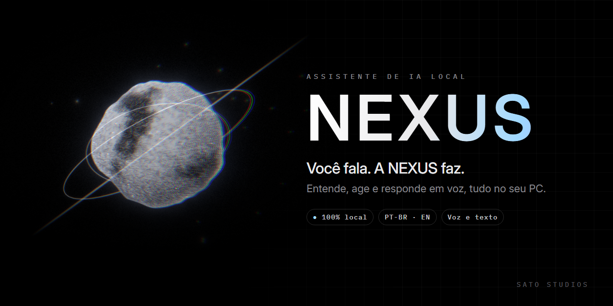
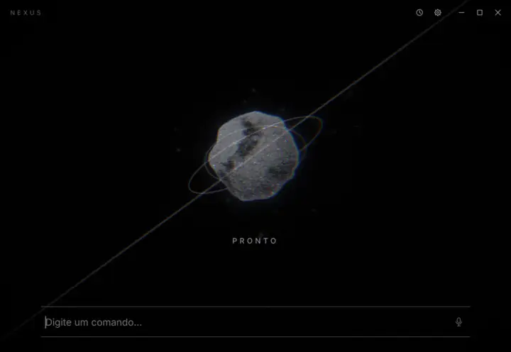
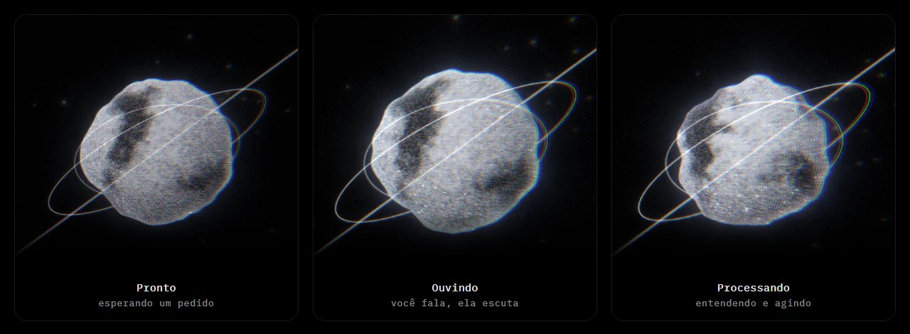
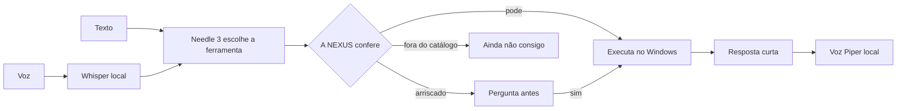

<p align="center">
  
</p>

<p align="center">
  <a href="https://github.com/satostudios/Nexus-IA/releases/latest"></a>
  <a href="LICENSE"></a>
  
  
  
  
</p>

A **NEXUS** é uma assistente de IA que opera o Windows por você. Você fala ou digita, ela entende qual ação você quer, confere se pode fazer, faz e responde em voz, em poucos segundos. Tudo roda no seu computador: sem conta, sem nuvem, sem assinatura.

Não é um chatbot. Se nenhuma ferramenta cobre o pedido, ela diz *"Ainda não consigo fazer isso"*, nunca inventa uma resposta. E quando você pede para **criar** algo (um poema, um e-mail, um app em Python, um site), um segundo modelo local escreve ao vivo no Bloco de Notas ou no seu editor de código.

<p align="center">
  
</p>

## O que ela faz

<table>
  <tr>
    <td width="50%" valign="top">&nbsp;<b>Voz e texto</b><br>&nbsp;Fale ou digite. No modo conversa ela ouve, responde e volta a ouvir sozinha.</td>
    <td width="50%" valign="top">&nbsp;<b>Abre e fecha programas</b><br>&nbsp;Chrome, Bloco de Notas, VS Code ou qualquer app do Menu Iniciar.</td>
  </tr>
  <tr>
    <td valign="top">&nbsp;<b>Pesquisa na web</b><br>&nbsp;Google, YouTube, Wikipédia, Maps e previsão do tempo, com as suas palavras.</td>
    <td valign="top">&nbsp;<b>Digita e aperta teclas</b><br>&nbsp;Ditado exato, Enter, Ctrl+S, nova aba. Pergunta antes de digitar em outra janela.</td>
  </tr>
  <tr>
    <td valign="top">&nbsp;<b>Escreve textos</b><br>&nbsp;Poemas, e-mails, cartas e listas, digitados ao vivo e salvos em <code>Documentos\NEXUS</code>.</td>
    <td valign="top">&nbsp;<b>Escreve programas</b><br>&nbsp;Apps em Python e sites, escritos ao vivo no seu editor, conferidos e prontos para rodar.</td>
  </tr>
  <tr>
    <td valign="top">&nbsp;<b>Arquivos e pastas</b><br>&nbsp;Procura, abre, cria, renomeia, move e manda para a Lixeira, sempre com confirmação.</td>
    <td valign="top">&nbsp;<b>Som e mídia</b><br>&nbsp;Volume, mudo, pausar, próxima e anterior.</td>
  </tr>
  <tr>
    <td valign="top">&nbsp;<b>Sistema</b><br>&nbsp;Horas, memória, prints da tela, bloquear, desligar e reiniciar (com confirmação).</td>
    <td valign="top">&nbsp;<b>Memória local</b><br>&nbsp;"Meu projeto da faculdade é D:\TCC" e depois "abra meu projeto da faculdade".</td>
  </tr>
</table>

## Como funciona

<p align="center">
  
</p>

O **Needle 3** é um modelo pequeno, feito para escolher ferramentas: ele lê o pedido e propõe a ação com os argumentos. A NEXUS confere essa proposta antes de qualquer coisa acontecer, executa no Windows e lê em voz só a frase final. O núcleo na tela reage ao microfone, ao processamento e à própria voz.

<p align="center">
  
</p>



## Instalação

### Jeito fácil: baixar o programa

1. Abra a página de **[Releases](https://github.com/satostudios/Nexus-IA/releases/latest)** e clique em **`NEXUS.exe`** para baixar.
2. Dê dois cliques no arquivo baixado.
3. Se o Windows mostrar *"O Windows protegeu o computador"*, clique em **Mais informações** e depois em **Executar assim mesmo**. O aviso aparece porque o programa ainda não tem assinatura digital paga.
4. Na primeira abertura, a NEXUS baixa os modelos de IA (algumas centenas de MB, só uma vez) e mostra o progresso. Depois disso ela funciona sem internet.

Precisa de Windows 10 ou 11 de 64 bits. Microfone e caixa de som são opcionais: dá para usar só digitando.

### Pelo código

Para quem quer estudar ou modificar. Precisa do [Python](https://www.python.org/downloads/) 3.10 a 3.13 (marque *Add python.exe to PATH* na instalação).

```powershell
git clone https://github.com/satostudios/Nexus-IA.git
cd Nexus-IA
.\setup.bat
.\run.bat
```

O `setup.bat` cria o ambiente, instala as dependências, baixa e confere os modelos e testa o microfone, a voz e uma chamada real ao Needle. Para gerar o seu próprio `NEXUS.exe`, rode `build.bat`.

## Como usar

| Você diz ou digita | A NEXUS faz |
| --- | --- |
| *abra o bloco de notas*, *abre o chrome*, *abrir o navegador* | Abre o programa |
| *feche o chrome* | Fecha sem forçar (o programa ainda pode pedir para salvar) |
| *pesquise receita de bolo de cenoura no google*, *como está o tempo hoje* | Abre a pesquisa no navegador |
| *abra o bloco de notas e digite olá, tudo bem?* | Abre e digita exatamente o que você ditou |
| *aperte enter*, *salve o arquivo*, *nova aba* | Aperta as teclas no programa aberto |
| *escreva um poema sobre o mar*, *escreve um email pro meu chefe pedindo folga* | Escreve o texto ao vivo e salva |
| *crie um jogo da velha em python*, *crie um site para a minha padaria* | Escreve o programa ao vivo no editor |
| *adicione um gráfico de gastos no app*, *rode o programa* | Muda o último programa ou roda (sempre pergunta antes) |
| *aumente o volume*, *pausa a música*, *próxima música* | Controla som e mídia |
| *abra minha pasta de downloads*, *procure arquivos chamados fatura* | Arquivos e pastas |
| *apague o arquivo velho.txt*, *desligue o computador* | Sempre pede confirmação |
| *que horas são*, *tire um print da tela*, *bloqueie o computador* | Sistema |

**Modo conversa:** clique no microfone (ou **Ctrl+Espaço**) uma vez. A NEXUS ouve, responde em voz e volta a ouvir. Para sair, diga **"parar"**, **"sair"** ou **"tchau"**, ou aperte **Esc**.

| Atalho | O que faz |
| --- | --- |
| **Enter** | Envia o comando digitado |
| **Ctrl+Espaço** | Fala |
| **Esc** | Para de ouvir, cancela uma confirmação ou interrompe a fala |
| **Ctrl+H** | Histórico |
| **Ctrl+D** | Painel de depuração (ferramenta, argumentos, confiança e tempos) |
| **Ctrl+,** | Configurações |

**Escrever leva alguns minutos** num notebook sem placa de vídeo: a NEXUS responde na hora, escreve em segundo plano enquanto continua ouvindo e avisa em voz quando termina. Na primeira vez ela pergunta antes de baixar o modelo de escrita (2,6 GB).

## Privacidade


**Nada sai do seu computador.** O Needle, o Whisper (reconhecimento de voz), o Piper (voz) e o modelo de escrita rodam na sua máquina. A internet só é usada para baixar os modelos na primeira vez.

<br clear="left">

- O áudio do microfone é processado na memória e nunca é gravado. O microfone só abre enquanto ela ouve.
- A telemetria do Needle vem **desligada**.
- Os registros ficam no seu PC e escondem o que parece senha, token ou chave.
- A memória guarda só o que você pede para lembrar e os últimos comandos. Tudo fica em `%APPDATA%\NEXUS` e pode ser apagado quando quiser.

## Segurança


**O Needle decide qual ação você quer. A NEXUS decide se ela pode rodar agora.** Cada proposta passa por cinco conferências antes de virar ação.

<br clear="left">

1. **Formato:** ferramenta desconhecida ou argumento faltando é descartado.
2. **Catálogo:** o pedido precisa combinar com as frases de uma ferramenta. Fora disso, *"Ainda não consigo fazer isso"*.
3. **Fidelidade:** argumentos que não vieram das suas palavras são recusados. Pedido negado ("não abra o chrome") nunca é executado.
4. **Alvo:** pastas do sistema (Windows, Arquivos de Programas, AppData) são bloqueadas. Terminal e a caixa Executar nunca recebem texto digitado.
5. **Confiança:** abaixo do limite, ela pergunta antes. Apagar, mover, renomear, desligar e rodar código **sempre** pedem confirmação. Apagar manda para a Lixeira.

Na dúvida ela pergunta: *"Qual arquivo: plano.txt em A ou plano.txt em B?"*, e você responde *"o segundo"*.

## Desempenho

Medido num Intel i5-1235U com 16 GB de RAM e sem placa de vídeo dedicada:

| Etapa | Tempo |
| --- | --- |
| Needle escolhe a ação | 0,3 a 1,1 s |
| Ação no Windows | menos de 0,3 s |
| Comando de voz, do fim da fala até a resposta falada | cerca de 4 a 5 s em português |
| Abertura até aceitar comandos digitados | cerca de 20 s |
| Poema curto | cerca de 35 s |
| App em Python de ~150 linhas | 7 a 9 min |

No teste de roteamento com o modelo real, **106 de 106** pedidos foram para a ferramenta certa: 48 em inglês e 58 em português.

## Limites conhecidos

- Ela não conversa sobre assuntos gerais: perguntas como *"quem descobriu o Brasil?"* não são respondidas. Só pedidos de criação usam o modelo de escrita.
- O Needle foi treinado em inglês. O português funciona por uma camada de tradução dos verbos de comando, então frases muito diferentes dos exemplos podem ser recusadas.
- Escrever é lento no processador de notebook. Os programas são pequenos e às vezes precisam de um ajuste (*"corrija o botão de salvar"*).
- O modelo de escrita precisa de uns 3 GB de RAM livres enquanto está carregado.
- No modo conversa, outras pessoas falando podem iniciar um comando. Tudo continua passando pelas mesmas conferências, e ações destrutivas continuam perguntando.
- Funciona só no Windows.

## Contribua

O projeto é aberto a melhorias. O **[guia técnico](docs/GUIA-TECNICO.md)** (em inglês) explica a arquitetura, a integração com o Needle, a voz, cada ferramenta, o modelo de segurança, como adicionar uma ferramenta e como rodar os testes.

```powershell
.venv\Scripts\python -m pytest
.venv\Scripts\python -m app.main --selftest
```

## Créditos

- **[Sato Studios](https://github.com/satostudios):** criação da NEXUS.
- **[Cactus Needle](https://pypi.org/project/cactus-needle/):** o Needle 3, que escolhe as ferramentas (Apache-2.0).
- **[faster-whisper](https://github.com/SYSTRAN/faster-whisper):** reconhecimento de voz local (MIT).
- **[Piper](https://github.com/OHF-Voice/piper1-gpl):** vozes neurais locais (GPL-3.0).
- **[llama.cpp](https://github.com/ggml-org/llama.cpp)** e **Qwen3.5:** o modelo de escrita, baixado à parte.
- **[PySide6](https://doc.qt.io/qtforpython-6/):** interface e o núcleo em OpenGL.
- **Inter** e **IBM Plex Mono:** fontes, sob a SIL Open Font License.

## Licença

O código da NEXUS é distribuído sob a licença [MIT](LICENSE): você pode usar, estudar, alterar e redistribuir, desde que mantenha o aviso de copyright. Os modelos e bibliotecas de terceiros têm licenças próprias, listadas em [NOTICE.md](NOTICE.md).

## In English

NEXUS is a local AI assistant that operates Windows for you. You speak or type, the Needle 3 model picks the action, NEXUS checks whether it may run, runs it and answers out loud, with nothing leaving your computer. It opens apps, searches the web, types, manages files, controls media and writes texts and small programs live in your editor. Made by Sato Studios and released under the MIT license. The full technical guide is in [docs/GUIA-TECNICO.md](docs/GUIA-TECNICO.md).
